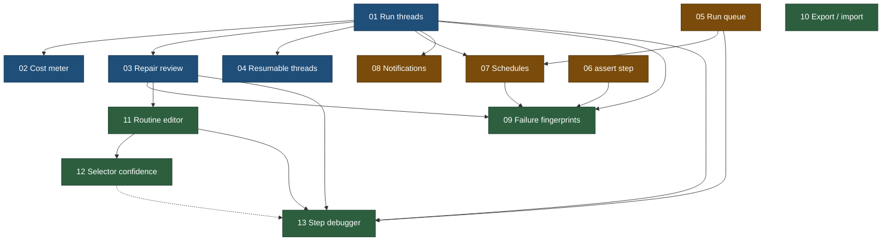

# Implementation order

The sequence the thirteen PRDs in [docs/prd/](prd/) should be built in, and why
that order and not another. Each PRD is self-contained; this document is the
argument for the sequence.

**One rule governs the whole ordering:** nothing that runs without a human present
ships before the app can show what it did, queue what overlaps, and stop mutating
the user's routines by itself. Everything else follows from that.

---

## The order

| # | Feature | Phase | Size | Depends on | Blocks |
|---|---|---|---|---|---|
| 1 | [Run threads](prd/01-run-threads.md) | Foundation | L | — | 2, 3, 4, 7, 8, 9 |
| 2 | [Run cost & budget meter](prd/02-cost-meter.md) | Foundation | S | 1 | — |
| 3 | [Repair review queue](prd/03-repair-review.md) | Foundation | M | 1 | 9, 11, 13 |
| 4 | [Resumable threads](prd/04-resumable-threads.md) | Foundation | M | 1 | — |
| 5 | [Run queue](prd/05-run-queue.md) | Unattended | S | — | 7, 13 |
| 6 | [`assert` step kind](prd/06-assert-step.md) | Unattended | S | — | 9 |
| 7 | [Schedules & triggers](prd/07-schedules.md) | Unattended | L | 1, 5 | 9 |
| 8 | [Hold & failure notifications](prd/08-notifications.md) | Unattended | M | 1 | — |
| 9 | [Failure fingerprints](prd/09-failure-fingerprints.md) | Durability | M | 1, 3, 6, 7 | — |
| 10 | [Routine export & import](prd/10-export-import.md) | Durability | S | — | — |
| 11 | [Routine editor](prd/11-routine-editor.md) | Durability | L | 3 | 12, 13 |
| 12 | [Selector confidence](prd/12-selector-confidence.md) | Durability | M | 11 | 13 (soft) |
| 13 | [Step-through debugger](prd/13-step-debugger.md) | Durability | L | 1, 3, 5, 11 | — |

Size is relative build effort, not a time estimate: **S** contained, **M**
meaningful, **L** the largest pieces in the set.

[docs/prd/README.md](prd/README.md)'s table is the authority on dependencies; this one
mirrors it. Two edges that were previously recorded as soft are hard: **3 → 11**, because
the repair write-back overwrites an editor's saves and revert is 03's own surface, and
**6 → 9**, because without assertions a fingerprint corpus only records "a step threw".

Credential vault is deliberately absent. It was in the original feature list and
was cut from this plan.

---

## Dependency graph

Solid arrows are hard blockers. Dotted arrows mark features that work without the
dependency but are materially worse for it.

**PRD 05, 06 and 10 have no upstream dependency at all.** They are placed by value
and by what they enable, not by necessity, and are the natural candidates for
parallel work.

---

## Phase 1 — Foundation: see what happened

**PRDs 01 → 02 → 03 → 04.** Nothing in the product is observable and nothing is
reversible. Everything here fixes that.

**Why first.** Six of the thirteen PRDs are hard-blocked on PRD 01, and nine of
them state a success metric that can only be measured once it exists. The product
emits no telemetry of any kind today, so building anything else first means
shipping blind and then retrofitting measurement.

**Why in this order inside the phase.**

- **01 first**, because everything else in the phase reads its tables.
- **02 second**, because it is a handful of columns on the table 01 just created and one
  panel in the view 01 just built. Doing it later means a second migration and a
  second pass over the same UI.
- **03 third**, because it closes an active data-loss risk — repairs currently
  overwrite user routines with no review, no version history and no undo
  ([ipc.ts](../src/main/ipc.ts) write-back path) — and that risk gets multiplied by
  Phase 2's scheduler. It comes before anything unattended, not after.
- **04 fourth**, because it is the largest read-path use of 01's data and can wait
  for the others.

**Ships as:** a Runs rail, a thread view per run, cost and repair visibility inside
it, routine version history with undo, and re-run / resume / save-from-thread.

**The phase is done when** every run — including a failed, cancelled or held one —
leaves a readable record, and no routine can change without someone deciding it
should.

### Cross-cutting decision this phase owns

**The renderer's structure.** It is 306 lines of vanilla TS with no routing,
component model, or list-detail pattern. Phase 1 adds a rail, a thread view, a
version history and a proposal queue; Phase 3 adds a step editor and a debugger.
Whether that stays vanilla TS or takes a framework should be decided during PRD 01,
while the first real UI is being built — not discovered during PRD 11, when the
largest UI in the product is already underway.

---

## Phase 2 — Unattended: run without a human

**PRDs 05 → 06 → 07 → 08.** The product's central promise, and the reason the
four-layer healing architecture exists.

**Why second.** It is the largest value unlock in the set and it is second, not
first, because scheduling on top of today's foundation ships four known defects at
machine speed:

| Missing | A scheduled run would… |
|---|---|
| PRD 01 | leave no evidence — unauditable actions taken against a real logged-in browser |
| PRD 05 | silently drop one of any two overlapping runs, every occurrence |
| PRD 03 | mutate the user's routines irreversibly on a timer, unwatched |
| PRD 06 | report success every morning while achieving nothing |

Each is survivable when someone is watching and none is survivable when nobody is.

**Why in this order inside the phase.**

- **05 first** — the smallest item in the phase, and PRD 07 is written assuming a
  busy state no longer exists. Doing it after would mean the scheduler learns about
  rejection and then unlearns it. Note it is *not* "contained to one class", as an
  earlier draft of this document claimed: starting a queued run when the extension
  reconnects needs connection state the orchestrator cannot see, so it also touches
  the bridge, the preload and the renderer's mirrored `busy` flag.
- **06 second** — also small, and it defines what "succeeded" means before anything
  starts succeeding unattended. It is what makes 07's success metric and 09's
  grouping worth anything.
- **07 third** — the payload. Everything above is in place.
- **08 fourth** — 07 is what makes holds happen while nobody is looking, so
  notifications land immediately after rather than before.

**Ships as:** cron schedules per routine with plain-language editing, a visible run
queue, `assert` steps, native notifications on holds and failures, and a global
pause-all.

**The phase is done when** a routine runs at 06:00, its result is readable at 08:00,
and anything that needed a person was announced when it happened.

### The blocking design question in this phase

**Which tab does a background run use?** The extension picks the active tab on start
([HOW-IT-WORKS.md](../HOW-IT-WORKS.md) §3, enforced by `chrome.tabs.query({active: true,
lastFocusedWindow: true})` in [background.js](../extension/background.js)). A schedule firing
while the user is working takes over the tab they are in.

This is more constrained than "open". `capture` in background.js **throws** unless the
automated tab is the visible one in its window, and it is the only screenshot path — both
routines in [updates/](../updates/) end in a `screenshot` step. So a dedicated *background*
tab can never screenshot, which rules out the mitigation PRD 07 originally proposed. The
decision space is really: a dedicated *window*, focused at run start; or deferral while the
user is active; or `screenshot` steps declared focus-requiring and skipped when unattended.

It still needs deciding before PRD 07 implementation begins — it is the one question in the
set that could change a PRD's shape rather than its details — but the active-tab requirement
is an input to that decision, not another unknown.

---

## Phase 3 — Durability: keep automations alive

**PRDs 09 → 10 → 11 → 12 → 13.** By here the product runs unattended and reports
honestly. This phase is about routines surviving the sites they drive.

**Why third.** Every feature in it either needs volume that only Phase 2 produces
(09), or is a large investment with no dependents (11, 12, 13), or is genuinely
independent and therefore correctly deferred (10).

**Why in this order inside the phase.**

- **09 first** — it needs the run corpus Phase 2 generates and it tells you which
  routines need the editor before you build one. It also delivers the metric
  baselines that 11, 12 and 13 are judged against.
- **10 second** — small, independent, complete, and finishes a code path the schema
  has reserved since the first migration but nothing can reach: `source: 'import'`
  is validated everywhere and written nowhere. A good short win between two long
  features.
- **11 third** — the largest renderer investment. Placed here it inherits versioning
  from 03, a step kind worth hand-authoring from 06, and a signal from 09 about
  which step to open.
- **12 fourth** — needs 11's editor as its home.
- **13 last** — composes more existing pieces than any other PRD: 05's queue, 11's
  editor, 12's resolution feedback, 01's transcript format. Built last it is mostly
  composition; built earlier it would drag most of that in with it.

**Ships as:** grouped failures with routine health, routines as portable files, a
step editor with undo, live selector feedback, and a step-through debugger with
committing actions blocked by default.

**The phase is done when** an Author can see a routine breaking, open the step,
fix it, test it without side effects, and export it.

---

## What can run in parallel

If more than one workstream is available:

| Track | Work | Notes |
|---|---|---|
| **A** | 01 → 02 → 03 → 04 | The critical path. Everything else waits on 01 |
| **B** | 05, 06, 10 | No upstream dependency. Can start immediately alongside 01 |
| **C** | 07 → 08 | Starts once 01 and 05 are both done |

PRDs 11, 12 and 13 should not be parallelised with each other — 12 and 13 both live
inside 11's UI, and building them concurrently would mean designing that UI three
times.

---

## Milestones

**M1 — Observable.** PRDs 01, 02. Every run leaves a readable, costed record.
*Answers: what did it do, and what did it cost?*

**M2 — Safe to leave alone.** Add PRDs 03, 05, 06. Nothing mutates without
approval, nothing is dropped, success means something.
*This is the gate. Scheduling before M2 is complete is the one sequencing mistake
that matters.*

**M3 — Unattended.** Add PRDs 04, 07, 08. Routines run on a schedule, announce
themselves, and are recoverable when they stop.
*This is the product's central promise, delivered.*

**M4 — Maintainable.** Add PRDs 09, 10, 11, 12, 13. Routines are visible, editable,
testable and portable.
*This is what keeps M3 true six months later.*

---

## Sequencing risks

| Risk | Why it matters | Handling |
|---|---|---|
| **Pressure to ship scheduling early.** PRD 07 is the most visibly valuable feature and is seventh. | Shipping it before M2 means unwatched, unreadable, irreversible runs against a real logged-in browser. | Treat M2 as a gate, not a guideline. If schedules must be demonstrated sooner, demo them behind a flag with a single routine — do not skip 01, 03 or 05. |
| **PRD 01 growing without bound.** It is the foundation, which makes it a magnet for scope. | A six-week PRD 01 delays everything. | Retention, artifact storage and the renderer decision are in scope. Grouping, resuming, accepting and cost display are explicitly other PRDs. |
| **The renderer decision deferred to PRD 11.** | Discovering the UI needs restructuring while building the largest UI in the product is the worst time to find out. | Decide during PRD 01. |
| **PRD 09 built before there is data to group.** | Grouping three failures is not grouping. | It is ninth for this reason. If Phase 2 slips, PRD 09 slips with it — do not pull it forward to fill a gap. |
| **PRD 06 treated as optional because it is small.** | Without assertions, every unattended success signal only means "no step threw". | It is the cheapest item in Phase 2 and the one that makes 07's and 09's metrics meaningful. Do not drop it for schedule. |

---

## What this plan does not include

- **Credential vault** — cut at the user's direction. Its absence means login-gated
  routines still end at a human hold every time, which PRD 08 at least makes
  visible.
- **Cloud or headless execution** — the premise is the user's own logged-in browser
  on their own machine ([ARCHITECTURE.md](../ARCHITECTURE.md) §1).
- **Multi-user, sharing services, or a routine registry** — PRD 10 delivers files,
  not a platform.
- **Event triggers** (webhooks, file watchers, page-change detection) — real demand,
  separate design. PRD 07 does cron only.
- **Click-to-pick selector capture** — noted as the natural companion to PRD 12 and
  deliberately not bundled into it.
